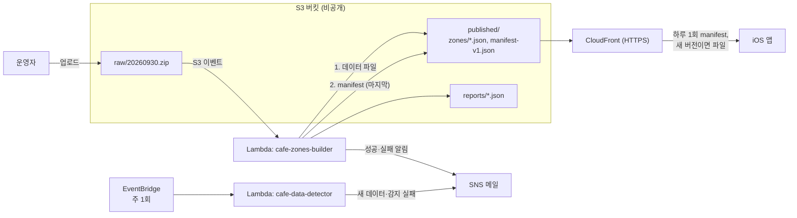

# 카페 구역 데이터 파이프라인 설계 — 앱 재배포 없이 카페 데이터 갱신하기

> 작성: 2026-10-31 · 상태: **설계만** (코드·데이터·AWS 리소스 미변경)
> 대상: `tools/cafe-zones` + AWS S3·Lambda·CloudFront·SNS + iOS `Features/Notification`
> 서버(`../server`)는 변경하지 않는다.
> 포털과 옵저빌리티는 `ops-console-plan.md`에서 다룬다. 이 파이프라인은 포털 없이도 메일만으로 동작한다.

---

## 1. 목적과 채택 근거

카페 근처 알림은 앱에 번들된 `Resources/CafeZones.json`을 쓴다. 지금 데이터를 갱신하려면 스크립트 실행, 커밋, 앱 재배포, 사용자 업데이트를 모두 거쳐야 한다.

이 설계는 **원본 파일을 S3에 올리면 Lambda가 생성·검증·게시하고, 앱이 다음 실행 때 스스로 교체**하게 만든다.

| 지금 | 변경 후 |
|---|---|
| 원본 다운로드 → 스크립트 → 검증 → 커밋 → 앱 재배포 → 사용자 업데이트 | 원본을 S3에 업로드 → Lambda 생성·검증 → 게시 → 앱이 교체 |

### 1.1 Lambda가 꼭 필요하지는 않다

갱신이 드물고 처리 시간도 짧아 GitHub Actions나 수동 실행으로도 충분하다. **이 과제는 이벤트 기반 서버리스 구조를 구현하는 도전 과제로 채택한다.** 다만 "앱 재배포 없이 데이터 교체"와 "검증 실패 시 게시 차단"은 어떤 실행 환경을 쓰든 실제로 얻는 가치다.

### 1.2 지켜야 할 원칙

- **위치 비공개 유지**: 앱은 항상 전국 파일 전체를 받는다. 어느 동을 골랐는지 밖으로 나가지 않는다.
- **진입 판정은 계속 오프라인**: `CafeNearbyStore.handleEntry`는 네트워크를 쓰지 않으며 이 설계로 바뀌지 않는다.
- **갱신 실패가 기능 장애가 되지 않음**: 무엇이 실패해도 기존 데이터나 번들 데이터로 계속 동작한다.
- **번들 파일 유지**: 첫 실행과 오프라인의 대비책이다. `CafeZones.json`을 손으로 고치지 않는 규칙도 그대로다.

---

## 2. 구조



### 2.1 동작 순서

1. 감지 Lambda가 주 1회 포털의 수정일을 확인하고, 바뀌었으면 메일을 보낸다(§2.4).
2. 운영자가 공공데이터포털에서 받은 zip을 `raw/<기준일>.zip`으로 올린다.
3. S3 이벤트가 빌드 Lambda를 깨운다.
4. Lambda가 zip을 `/tmp`로 받아 구역을 만들고 검증한다(§4).
5. 통과하면 `zones/<버전>.json`을 올리고 변경 요약을 메일로 보낸다. 게시 방식에 따라 바로 또는 승인 후 **마지막에** manifest를 바꾼다(§2.5). 실패하면 manifest를 건드리지 않고 메일로 알린다.
6. 앱이 포그라운드 진입 때 하루 한 번 manifest를 확인하고, 새 버전이면 받아서 검증한 뒤 교체한다(§6).

### 2.2 설계 결정

| 결정 | 이유 |
|---|---|
| **게시 순서는 파일 먼저, manifest 나중** | manifest가 가리키는 파일이 항상 존재한다. 중간에 실패해도 사용자는 기존 버전을 그대로 본다 |
| **버전 파일은 덮어쓰지 않음** | 롤백은 manifest만 되돌리면 된다. CDN 캐시 불일치도 생기지 않는다 |
| **형식 버전은 경로로 구분**(`manifest-v1.json`) | 호환되지 않는 형식을 낼 때 `manifest-v2.json`을 추가하면 구버전 앱은 v1을 계속 읽는다. 앱 버전 비교 로직이 필요 없다 |
| **앱은 켠 사용자만 확인** | 카페 근처 알림이 꺼져 있으면 manifest도 조회하지 않는다 |
| **교체는 포그라운드에서만** | 위치 이벤트로 깨어날 때 `start()`는 카탈로그를 읽지 않는다는 기존 동작을 유지한다. 등록된 구역은 시스템이 기억한다 |
| **EC2·서버 API를 쓰지 않음** | 정적 파일 배포로 충분하고, 서버가 좌표를 받지 않는다는 도메인 계약과도 맞는다. EC2의 외부 인터넷 제약과도 무관하다 |
| **Lambda 런타임은 Python 현행 버전** | 기존 스크립트를 재사용한다. `boto3`는 런타임에 포함되고, `build_zones.py`·`check_zones.py`는 표준 라이브러리만 쓰는 상태를 유지한다 |
| 배포는 **수동** | AWS CLI로 zip을 올린다. 절차는 구현 시 `tools/cafe-zones/README.md`에 적는다 |

### 2.3 대안

| 대안 | 판단 |
|---|---|
| GitHub Actions에서 실행 | 가장 단순하고 실용적이다. 원본 340MB를 레포 밖에서 받아 와야 한다. 서버리스 과제 취지에는 맞지 않아 제외 |
| 수동 실행 후 S3에 올리기 | 예비안. Lambda가 막히면 §6의 앱 교체 구조는 이 방식으로도 그대로 쓸 수 있다 |
| 서버 API로 내려주기 | EC2 부하와 배포 의존이 생기고 서버가 카페 데이터를 들고 있게 된다. 제외 |
| 동별 파일 분할 | 전송량은 줄지만 어느 동을 받는지 드러나 위치 비공개 원칙을 깬다. **제외** |

### 2.4 새 데이터 감지 (`cafe-data-detector`)

**업로드는 자동화하지 않고, 새 데이터가 나왔는지만 자동으로 알린다.** [공공데이터포털 상세 페이지](https://www.data.go.kr/data/15083033/fileData.do)에서 고정 다운로드 주소나 자동 수집용 API를 확인하지 못했고, 분기 1회 업로드는 수작업 부담이 작기 때문이다.

```text
EventBridge 주 1회 → Lambda
  상세 페이지에서 수정일 읽기
  ├─ 읽기 실패 → 실패 메일 ("새 데이터 없음"으로 넘기지 않는다)
  ├─ state/detector.json 값과 같음 → 종료
  └─ 다름 → 새 데이터 메일 후 값 저장
```

- 파일은 내려받지 않는다.
- 페이지 구조가 바뀌면 메일이 조용히 끊길 수 있으므로, 읽기 실패를 반드시 메일로 알린다.
- 고장 나도 앱과 게시 흐름에는 영향이 없다.
- 자동 조회가 포털 이용 정책에 맞는지 착수 전에 확인한다. → §9 미결 2

### 2.5 게시 방식

| 방식 | 동작 | 쓰는 시기 |
|---|---|---|
| `auto` | 검증 통과 시 바로 manifest 교체. 파일을 올린 사람의 업로드를 승인으로 본다 | 포털 완성 전 |
| `approval` | 검증 통과 시 리포트에 `PENDING_APPROVAL`만 기록하고 manifest는 그대로 둔다. 관리자가 포털에서 승인하면 게시 | 포털 완성 후 |

- Lambda 환경변수 `PUBLISH_MODE`로 고른다. **기본값은 `approval`** 이고, 포털 전 단계에서만 `auto`로 명시한다. 설정이 빠졌을 때 자동 게시되지 않게 하기 위해서다.
- 업로드 자체가 사람을 안전장치로 만들지는 않는다. 340MB 파일을 올리면서 내용을 볼 수 없기 때문이다. 실제 확인 지점은 **변경 요약을 읽는 순간**이다(§4.3).

---

## 3. 데이터 형식

### 3.1 manifest (`published/manifest-v1.json`)

```json
{
  "version": "2026-09-30.1",
  "path": "zones/2026-09-30.1.json",
  "sha256": "<압축 해제 후 파일의 SHA-256>",
  "size": 1199142
}
```

### 3.2 버전 규칙

- 형식은 `<원본 기준일>.<재생성 번호>`이고, 문자열 비교로 순서를 정한다.
- 같은 원본을 규칙 변경으로 다시 만들면 재생성 번호를 올린다.
- 데이터 파일 최상위에 `version` 키를 추가한다. 구버전 앱의 디코더는 모르는 키를 무시하므로 v1 호환이다.
- 번들 파일도 스크립트로 다시 만들어 `version`을 넣는다. 그래야 앱이 번들과 다운로드 중 어느 쪽이 새것인지 비교할 수 있다.

### 3.3 S3 키와 캐시

| 경로 | 공개 | `Cache-Control` | 비고 |
|---|---|---|---|
| `raw/<기준일>.zip` | 비공개 | — | 수명 주기로 90일 후 삭제 |
| `published/zones/<버전>.json` | CloudFront로만 | `max-age=31536000, immutable` | 덮어쓰지 않음 |
| `published/manifest-v1.json` | CloudFront로만 | `max-age=300` | 롤백이 5분 안에 반영됨 |
| `published/history/manifest-v1-<버전>.json` | CloudFront로만 | 같음 | 롤백용 사본 |
| `reports/<버전>.json` | 비공개 | — | 변경 요약과 게시 상태 (§4.3) |
| `state/detector.json` | 비공개 | — | 마지막으로 확인한 포털 수정일 |

- CloudFront 오리진 경로를 `/published`로 고정해 `raw/`와 `reports/`는 노출되지 않게 한다.
- CloudFront 자동 압축을 켠다. 현재 파일은 1,199,142B이고 gzip으로 약 333KB다. `URLSession`이 자동으로 풀어 주므로 `sha256`과 `size`는 압축 해제 기준이다.

---

## 4. `tools/cafe-zones` 변경

**기존 스크립트를 그대로 Lambda에서 돌릴 수는 없다.** 코드를 읽어 확인한 문제는 다음과 같다.

| 위치 | 문제 | 변경 |
|---|---|---|
| `check_zones.py:88-90` | 번들의 양재2동이 **고정 fixture(2026-06-30 데이터)의 묶기 결과와 정확히 같아야** 통과한다. 새 원본에서 양재2동 카페가 하나만 바뀌어도 **정상 데이터가 항상 실패한다** | 이 비교는 fixture와 기준일이 같을 때만 수행. 새 데이터는 §4.1의 직전 버전 비교로 검사 |
| `check_zones.py:60` | 검사 대상이 `DEFAULT_OUT`으로 고정 | `--file`, `--previous` 인자 추가 |
| `check_zones.py:28` | `failures`가 모듈 전역이다. Lambda는 실행 환경을 재사용하므로 **이전 실행의 실패가 다음 실행에 남는다** | `run_checks(path, previous) -> list[str]` 함수로 바꾸고, CLI는 이를 감싼다 |
| `check_zones.py:68` | 최상위 키를 정확히 비교 | `version` 포함으로 수정 |
| `build_zones.py:33` | `SOURCE`에 기준일 `2026-06-30`이 고정 | `--source-date`, `--version` 인자 추가. `build()`도 이 값을 받음 |
| `build_zones.py:155` | 실패 시 `sys.exit` | CLI는 유지하고, `build()`는 예외를 던지도록 변경 |

골든 검사(`golden()`)는 원본과 무관한 **묶기 알고리즘 회귀 테스트**이므로 그대로 둔다.

### 4.1 직전 버전 대비 검사 (신규)

스키마 검사만으로는 "형식은 맞지만 내용이 잘못된" 파일을 막지 못한다. 예를 들어 일부 시도의 CSV가 빠진 zip이 그렇다.

| 검사 | 기준(제안) | 실패 시 |
|---|---|---|
| 동 수 변화 | ±5% 이내 | 차단 |
| 전체 구역 수 변화 | ±15% 이내 | 차단 |
| 전체 카페 수(`count` 합) 변화 | ±15% 이내 | 차단 |
| 시도 수 | 직전과 동일 | 차단 |
| 양재2동 존재 | 코드 `11650652` | 차단 |
| 사라진 동 목록 | 차단 안 함 | 리포트에 기록 (§6.3) |

현재 번들은 동 3,462개, 구역 34,626개다. 기존 하한 `MIN_DONGS = 3,400`과 차이가 작으므로, 실제 다음 분기 데이터로 하한이 적절한지 확인한다. → §9 미결 3

### 4.2 Lambda 진입점 (`tools/cafe-zones/lambda_handler.py`)

```text
1. 이벤트에서 키 추출. raw/<YYYYMMDD>.zip 형식이 아니면 실패
2. 다음 재생성 번호 결정. 같은 기준일 버전이 있고 원본 ETag도 같으면 이미 처리한 것으로 보고 종료
3. zip을 /tmp로 다운로드 → build() → 임시 파일에 저장
4. 직전 버전 다운로드 → run_checks(새 파일, 직전 파일)
5. 실패: 리포트 저장, 예외 발생 → 실패 대상 SNS로 메일
6. 성공: zones/ 업로드 → 리포트 저장
   - PUBLISH_MODE=auto: history/ 사본 → manifest 교체 → 리포트 상태 PUBLISHED
   - PUBLISH_MODE=approval: 리포트 상태 PENDING_APPROVAL (manifest 그대로)
   → 변경 요약을 SNS 메일로 발송
7. /tmp 정리
```

### 4.3 리포트와 변경 요약

사람이 판단할 수 있도록 성공과 실패 모두 같은 형식으로 남긴다. 메일 본문과 포털이 이 파일을 함께 쓴다.

```json
{
  "version": "2026-09-30.1",
  "previousVersion": "2026-06-30.1",
  "status": "PENDING_APPROVAL",
  "sourceKey": "raw/20260930.zip",
  "sourceEtag": "<원본 ETag>",
  "summary": {
    "dongs": { "previous": 3462, "current": 3470 },
    "zones": { "previous": 34626, "current": 34900 },
    "cafes": { "previous": 0, "current": 0 },
    "removedDongs": [ { "code": "...", "label": "..." } ],
    "addedDongs": [ { "code": "...", "label": "..." } ]
  },
  "failures": [],
  "durationSeconds": 0,
  "createdAt": "2026-10-31T00:00:00Z"
}
```

위 수치는 형식 예시다. `status`는 `FAILED`·`PENDING_APPROVAL`·`PUBLISHED`·`REJECTED` 중 하나다. 메일과 로그에 원본 내용 전체를 넣지 않는다.

---

## 5. AWS 구성

| 항목 | 값 |
|---|---|
| Lambda 메모리 | 1,769MB에서 시작 (vCPU 1개). 측정 후 조정 |
| Lambda 제한 시간 | 10분. 측정 후 조정 |
| 임시 저장 공간 | 1GB. zip은 약 340MB이고 압축 해제 없이 스트리밍으로 읽는다(해제 시 약 1.5GB) |
| 동시 실행 | 예약 동시성 1. 두 업로드가 manifest를 동시에 바꾸지 못하게 한다 |
| 비동기 재시도 | 0회. 검증 실패는 재시도해도 같은 결과다. 실패는 SNS로 받고 다시 올려 재실행한다 |
| S3 트리거 | 접두사 `raw/`, 접미사 `.zip`. **Lambda가 쓰는 `published/`와 겹치지 않아 재귀 호출이 생기지 않는다** |
| S3 버킷 | 퍼블릭 액세스 전면 차단, 기본 암호화, CloudFront OAC로만 `published/` 읽기 허용 |
| CloudFront | HTTPS 전용, 자동 압축, 기본 도메인 사용. 액세스 로그 **끔** |
| 빌드 Lambda IAM | `raw/*` 읽기, `published/*`·`reports/*` 읽기·쓰기, 해당 버킷 목록, SNS 발행, 로그. 삭제 권한 없음 |
| 감지 Lambda IAM | `state/detector.json` 읽기·쓰기, SNS 발행, 로그. 빌드 Lambda와 역할을 나눈다 |
| 감지 일정 | EventBridge 주 1회. 실패 시 SNS 메일 |

README에 전국 처리 약 15초로 적혀 있지만, 이는 로컬 실행 기준이다. **Lambda에서의 실행 시간과 메모리는 측정 전이다.** 지금 수치로 보면 제한 안에 들어올 것으로 예상하지만 2단계에서 확인한다.

**비용(추정).** 이 규모면 월 1달러 미만이다. 대부분 프리 티어 안이거나 저장 비용 수준이다. 착수 전 현재 요금표로 확인한다.

**계정.** VPC를 쓰지 않으므로 EC2와 같은 계정일 필요가 없다. 운영 환경에 제약이 있으면 별도 계정을 쓸 수 있다. **운영 서버와 운영 DB에는 접근하지 않는다.**

---

## 6. iOS 변경

의존 규칙(`CLAUDE.md`)을 따른다. View는 Store만 호출하고, Data는 같은 Feature의 다른 폴더를 모른다.

| 파일 | 변경 |
|---|---|
| `Features/Notification/Data/CafeZoneCatalog.swift` | `version` 디코딩 추가. 번들 어댑터는 유지 |
| `Features/Notification/Data/CachedCafeZoneCatalog.swift` (신규) | 저장 파일이 번들보다 새것이고 유효하면 그것을, 아니면 번들을 읽는 어댑터 |
| `Features/Notification/Data/CafeZoneRemoteSource.swift` (신규) | manifest·파일 조회 포트와 `URLSession` 어댑터. **`APIClient`를 쓰지 않는다**(다른 호스트, JWT 불필요) |
| `Features/Notification/Data/CafeZoneUpdater.swift` (신규) | 버전 비교 → 다운로드 → 검증 → 원자적 교체 |
| `Features/Notification/Data/CafeNearbyLocalStore.swift` | 마지막 확인 시각 추가 |
| `Features/Notification/Store/CafeNearbyStore.swift` | `refreshZonesIfNeeded()` 추가, 사라진 동 처리 |
| `Features/Notification/Views/CafeNearbyRows.swift` | 사라진 동 안내 |
| `App/AppDelegate.swift` | 카탈로그 조립 교체 (17행) |
| `App/ContentView.swift` | 포그라운드 진입 시 `refreshZonesIfNeeded()` 호출 |
| `tools/cafe-zones`, `Resources/CafeZones.json` | `version`을 넣어 스크립트로 재생성 |

- 데이터 URL은 `BASE_URL`과 같은 방식으로 설정한다. **값이 없으면 갱신 기능이 꺼지고 번들만 쓴다.** `Secrets.plist`가 없는 worktree의 테스트는 네트워크를 쓰지 않는다.
- 반경은 앱의 고정값 150m를 유지한다. `check_zones.py`가 `radiusM == 150`을 강제하므로 v1에서 어긋날 수 없다. 반경을 바꾸려면 `manifest-v2`로 낸다.

### 6.1 갱신 절차

```text
조건: 알림 켜짐 · 데이터 URL 있음 · 마지막 확인 후 24시간 경과
1. manifest 조회
2. 현재 사용 버전과 같으면 종료
3. size > 4MB 이면 중단
4. 파일 다운로드 → sha256·size 일치 확인
5. 디코딩 후 내용 검증: 동 3,400개 이상, 동마다 구역 1~17개, 좌표 국내 범위
6. 임시 파일에 쓴 뒤 원자적으로 교체 (Application Support, 백업 제외)
7. 카탈로그 다시 읽기 → 선택한 동의 구역이 달라졌을 때만 지오펜스 재등록
```

- 어느 단계든 실패하면 기존 데이터를 그대로 쓰고 사용자에게 오류를 표시하지 않는다. 사용자가 할 수 있는 일이 없기 때문이다. 다음 확인 때 다시 시도한다.
- 앱이 내용을 다시 검증하는 이유는 파이프라인이나 버킷에 문제가 생겨도 잘못된 구역이 기기에 등록되지 않게 하려는 것이다.
- 구역 ID는 이미 좌표 기반이다(`CafeNearbyStore.zoneID`). 7번 비교는 `monitoredZoneIDs()`로 할 수 있다. 불필요한 재등록을 피하면 재등록 직후의 진입 이벤트도 줄어든다.

### 6.2 어떤 데이터를 쓸지 결정

| 저장 파일 | 결과 |
|---|---|
| 없음 또는 손상 | 번들 |
| 번들보다 오래됨 (앱 업데이트 후) | 번들을 쓰고 저장 파일 삭제 |
| 번들보다 새로움 | 저장 파일 |

**롤백.** manifest 버전이 현재 버전과 다르면 더 오래된 버전이어도 내려받는다. 다만 번들보다 오래된 버전을 가리키면 저장 파일을 지우고 번들로 돌아간다.

**로그아웃.** 카페 구역 파일은 사용자 데이터가 아니므로 `CafeNearbyLocalStore.reset()`이 지우지 않는다.

### 6.3 사라진 동 처리

행정동 개편이나 카페 폐업으로 동이 파일에서 사라질 수 있다. 지금은 [`selectedDongs`](../captest1/Features/Notification/Store/CafeNearbyStore.swift)가 `compactMap`으로 해당 코드를 조용히 뺀다. 고른 동이 모두 사라지면 **아무 안내 없이 구역이 0개가 되어 알림이 끊긴다.**

- 교체 후 사라진 코드를 선택에서 제거하고 `localStore`에 반영한다.
- 설정의 카페 근처 항목에 "선택한 동의 데이터가 바뀌었어요. 다시 골라 주세요."를 표시한다.
- 구역이 0개가 되면 `monitor.removeAll()`로 상태를 명확히 한다.
- 동 이름을 비교해 새 코드로 자동 이전하지 않는다. 잘못 옮기면 사용자 모르게 다른 동을 감시하게 된다.

---

## 7. 실패 시나리오와 검증

### 7.1 실패 시나리오

| 상황 | 결과 | 대응 |
|---|---|---|
| 일부 시도가 빠진 zip | §4.1에서 차단, manifest 그대로 | 메일 확인 후 올바른 파일 재업로드 |
| 잘못된 파일 이름 | Lambda 실패, 게시 없음 | 메일 확인 후 이름 수정 |
| 원본 CSV 열 이름 변경 | 카페 0건으로 차단 | `build_zones.py` 수정 후 재배포 |
| Lambda 시간 또는 메모리 초과 | 게시 없음, 실패 메일 | 설정 조정 후 재업로드 |
| 같은 이벤트 중복 전달 | 같은 ETag면 건너뜀 | 없음 |
| 파일 업로드 후 manifest 교체 실패 | 사용자는 기존 버전 | 재업로드. 남은 버전 파일은 무해 |
| 나쁜 데이터가 게시됨 | 검증을 통과했지만 내용이 틀림 | history의 manifest 복사로 롤백. 최대 5분 + 다음 확인 주기(최대 24시간) 후 반영 |
| CloudFront 장애, 오프라인 | 확인 실패 | 기존 데이터로 계속 동작 |
| 다운로드 중 앱 종료 | 임시 파일만 남음 | 다음 확인 때 다시 시도 |
| 압축 전 파일 손상 | sha256 불일치 | 교체하지 않음 |
| 포털 페이지 구조 변경 | 감지 실패 메일, 게시 흐름은 영향 없음 | 감지 코드 수정. 그동안 포털을 직접 확인 |
| 새 데이터 메일을 놓침 | 앱은 기존 데이터로 정상 동작 | 다음 분기에 함께 처리 가능 |
| 승인 대기 중 더 새로운 파일 업로드 | 두 버전이 모두 `PENDING_APPROVAL` | 더 오래된 버전은 승인 거부. 직전 게시 버전 기준으로 다시 비교한 리포트를 사용 |

### 7.2 검증

커밋된 해시를 별도 worktree에서 확인한다. 앱 실행과 테스트는 `Secrets.plist`가 없는 worktree에서 한다(상위 `CLAUDE.md`).

| 단계 | 방법 | 필요한 것 |
|---|---|---|
| 스크립트 | `check_zones.py`로 현재 번들 재생성 후 통과. **좌표 내용이 달라지지 않았는지**(`version` 외 동일) 확인 | 원본 zip |
| 직전 비교 | 시도 하나를 뺀 파일, 동 10% 줄인 파일, 값 일부를 바꾼 정상 파일 | 파이썬만 |
| 전역 상태 | `run_checks`를 실패 → 성공 순으로 호출해 두 번째가 통과하는지 | 파이썬만 |
| Lambda 진입점 | S3 부분을 페이크로 바꿔 게시 순서 확인. 실패 시 manifest 미변경, `approval` 모드에서 manifest 미변경, `PUBLISH_MODE` 누락 시 `approval` 동작 | 파이썬만 |
| 감지 Lambda | 저장된 HTML 샘플로 수정일 같음·다름·읽기 실패 | 파이썬만 |
| 앱 단위 | §6.1 각 단계 실패, §6.2 표, 롤백, 사라진 동, 구역 불변 시 재등록 없음 | `FakeCafeZoneCatalog`, `URLProtocol` 스텁 |
| AWS 통합 | 실제 전국 zip으로 시간·메모리 측정, 깨진 zip 차단 확인 | AWS 계정 |
| 종단 | 시뮬레이터 앱이 새 버전을 받아 동 선택 화면에 반영 | CloudFront, 시뮬레이터 UDID |

`CafeZoneCatalogTests`는 번들 어댑터를 직접 시험하므로 유지한다. `-only-testing:captest1Tests`로 기존 테스트 회귀를 확인한다.

### 7.3 시연 시나리오

1. 앱의 현재 데이터 버전을 표시한다.
2. **일부 시도를 뺀 zip을 올린다** → 차단 메일을 보여주고, 앱에는 변화가 없음을 확인한다.
3. 정상 zip을 올린다 → 성공 메일과 변경 요약을 보여준다.
4. 앱을 다시 연다(시연 때는 24시간 조건을 낮춘 빌드) → 재배포 없이 데이터가 바뀐다.
5. manifest를 되돌려 롤백까지 보여준다.

이 시나리오를 위해 설정 화면에 데이터 기준일을 작게 표시한다. 공공데이터 출처 표기 위치로도 쓸 수 있다.

---

## 8. 단계

| 단계 | 내용 | 완료 기준 |
|---|---|---|
| 0 | §9의 1·2 확인 | 진행 가능 여부 결정 |
| 1 | §4 스크립트 수정, 번들 재생성 | AWS 없이 로컬에서 정상 파일 통과, 잘못된 파일 차단 |
| 2 | S3·빌드 Lambda·SNS 구성 (`PUBLISH_MODE=auto`) | 실제 zip으로 게시 성공, 변경 요약 메일 수신, 시간·메모리 측정값 기록, 깨진 zip 차단 |
| 3 | CloudFront 구성 | manifest와 파일을 HTTPS로 받고 `raw/`는 접근 불가 |
| 4 | 앱 어댑터·갱신기 | 단위 테스트 통과, 번들 대비 동작 |
| 5 | 앱 Store·설정 연결, 사라진 동 안내 | 시뮬레이터에서 새 버전 반영, 지오펜스 재등록 확인 |
| 6 | 감지 Lambda | 수정일 변경과 읽기 실패 모두 메일 수신 |
| 7 | README·로드맵 갱신, 시연 리허설 | §7.3 전체 수행 |
| 8 | 포털 승인 연결 후 `PUBLISH_MODE=approval` 전환 (`ops-console-plan.md`) | 승인 전에는 manifest가 그대로이고, 승인 후 앱에 반영 |

**1단계에서 `check_zones.py` 문제를 먼저 해결한다.** Lambda 없이도 값이 있는 수정이고, 이후 단계가 전부 여기에 의존한다.

---

## 9. 미결 사항

**착수 전에 사용자가 확인해야 하는 것.**

1. **AWS 계정과 권한**: S3, Lambda, CloudFront, SNS를 만들 수 있는 계정이 있는지. EC2 계정이 제한되어 있으면 별도 계정을 쓸 수 있는지.
2. **공공데이터 이용 조건**: 상세 페이지에 이용허락범위 "제한 없음"으로 표기되어 있다(2026-10-31 확인, 도구 요약 기준). 포털 이용 정책 원문에서 가공 데이터 공개 배포, 출처 표기 방식, 상세 페이지의 주기적 자동 조회가 허용되는지 직접 확인한다.

**결정이 필요한 것.**

3. **검사 기준값**: §4.1의 ±5%·±15%와 `MIN_DONGS`. 실제 분기 간 변동을 모르는 상태의 제안값이므로 다음 원본으로 조정한다.
4. **시연용 새 데이터**: 포털의 수정일이 2026-10-30이라 2026-06-30보다 새 원본이 있을 수 있다. 내려받아 기준일을 확인하고, 없으면 현재 원본을 일부 수정한 시험 파일로 대체한다.

**정해진 것.**

- 게시 방식: 포털 전에는 `auto`, 포털 후에는 `approval`(§2.5).
- 원본 수집: 업로드는 수동, 감지만 자동(§2.4). 포털이 안정적인 고정 주소를 제공하고 이용 정책도 허용한다고 확인되면 완전 자동화를 다시 검토한다. 그 경우에도 승인 단계는 유지한다.
- 갱신 주기: 상세 페이지 표기는 분기다.

---

## 10. 범위 밖

| 항목 | 이유 |
|---|---|
| 동별 분할 다운로드, 델타 업데이트 | 위치 비공개 원칙 위반 또는 복잡도 대비 이득이 작다(gzip 약 333KB) |
| 원본 자동 다운로드 | §2.4. 감지와 메일까지만 자동화한다 |
| 묶기 규칙 변경 | 이 과제는 전달 경로만 다룬다 |
| 서버 변경 | 좌표를 받지 않는 도메인 계약 유지 |
| 백그라운드 다운로드 | 포그라운드 확인으로 충분하고 분기 단위 데이터라 지연이 문제되지 않는다 |
| CD 자동화, IaC | 수동 배포 유지. 구성 절차는 문서로 남긴다 |

---

## 11. 관련 문서

- 현재 생성·검증 규칙: `../tools/cafe-zones/README.md`
- 앱 구조·의존 규칙: `../CLAUDE.md`
- 서버 도메인 계약(좌표 미수신): `../../server/CLAUDE.md`
- 로드맵 배치 메모: `feature-roadmap.md` §5
- 포털·옵저빌리티·전체 일정: `ops-console-plan.md`
