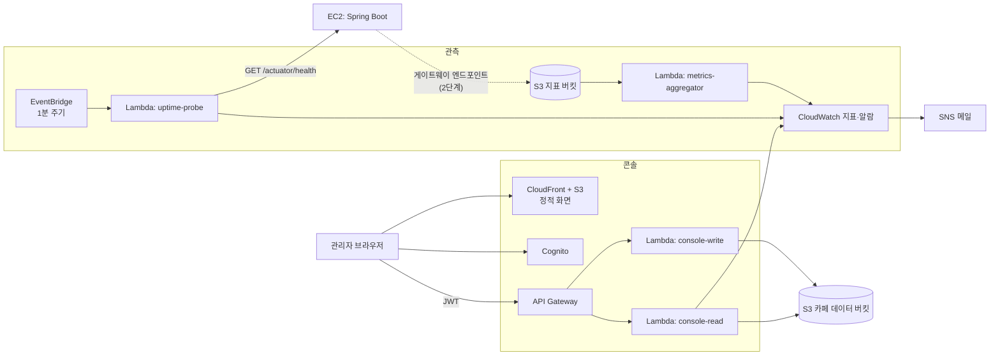

# 운영 콘솔 설계 — 옵저빌리티와 데이터 관리

> 작성: 2026-10-31 · 상태: **설계만** (코드·AWS 리소스 미변경)
> 대상: 새 레포 `ops-console/`(제안) + AWS 서버리스 구성 + 서버의 지표 내보내기(선택 단계)
> 선행: `cafe-zone-pipeline-plan.md`. 새 레포를 만들면 이 문서를 그쪽으로 옮긴다.

---

## 1. 목적과 범위

### 1.1 풀려는 문제

운영 EC2는 외부 인터넷에 나갈 수 없고, 운영 프로파일은 `health`만 공개하며(`application-prod.yaml`), 로그는 EC2 안의 Docker 로그 파일에만 남는다. 지금은 서버가 내려가도 앱을 열어 보기 전까지 알 수 없다.

이 콘솔은 **"인터넷이 막힌 서버를 어떻게 관측할까"** 를 풀고, 카페 데이터 게시를 한 화면에서 관리한다. 거의 쓰이지 않는 관리 도구이므로 서버리스와 잘 맞는다.

### 1.2 범위

| 포함 | 제외 | 제외 이유 |
|---|---|---|
| 가용성, API 오류율, API 응답 시간 | 분산 추적, 범용 로그 검색 | 규모 대비 과함 |
| 장애·복구 메일 | 복잡한 알림 규칙 | 관리자가 소수 |
| 카페 데이터 버전, 검사 결과, 변경 요약 | 범용 데이터 편집 화면 | 데이터 종류별 검증이 달라 공통화 이득이 없음 |
| 원본 업로드, 게시 승인, 롤백 | 서버 재시작, 배포 | 수동 배포 결정과 충돌하고, 인터넷에 노출된 화면에서 운영 서버를 조작하게 됨 |
| 음료 프리셋 관리(선택, §6) | 사용자 카페인·수면 기록 조회 | 민감한 건강 데이터를 볼 이유가 없음 |

**콘솔이 고장 나도 앱과 서버는 영향을 받지 않아야 한다.** 앱은 콘솔을 호출하지 않고, 지표 전송 실패는 API 처리에 영향을 주지 않는다.

---

## 2. 구조



### 2.1 설계 결정

| 결정 | 이유 |
|---|---|
| **지표 저장은 CloudWatch** | 시계열 DB를 직접 운영하지 않는다. 알람과 SNS 연결이 기본 제공된다 |
| **콘솔 전용 DB 없음** | 데이터 상태는 S3 리포트, 지표는 CloudWatch에 이미 있다 |
| **읽기와 쓰기 Lambda 분리** | 조회 경로가 뚫려도 게시 권한으로 이어지지 않는다 |
| **서버 `ADMIN` 계정과 연결하지 않음** | 운영 서버는 HTTPS가 적용되지 않아 관리자 비밀번호가 평문으로 오갈 수 있다. Cognito로 분리한다 |
| **콘솔은 RDS에 접근하지 않음** | 사용자 데이터를 볼 경로 자체를 만들지 않는다 |
| **배포는 수동** | CD 자동화 금지 결정을 따른다 |
| **새 레포 `ops-console/`** | 서버와 앱 어디에도 속하지 않는다. 상위 `CLAUDE.md`의 레포 목록과 역할도 함께 고친다. 카페 Lambda는 기존 스크립트를 쓰므로 `captest1/tools/cafe-zones`에 둔다 |

---

## 3. 옵저빌리티

### 3.1 신호

| 신호 | 수집 방법 | 서버 변경 | 단계 |
|---|---|---|---|
| 가용성 | 외부에서 `/actuator/health` 호출 | 없음 (이미 공개) | 1단계 |
| 외부 응답 시간 | 위 호출의 소요 시간 | 없음 | 1단계 |
| API 오류율 | 서버 내부 집계 → S3 → CloudWatch | **있음** | 2단계 |
| API 응답 시간 | 서버 내부 집계 → S3 → CloudWatch | **있음** | 2단계 |
| 파이프라인 상태 | 카페 데이터 리포트, 감지 결과 | 없음 | 1단계 |

### 3.2 1단계: 외부 가용성 확인

```text
EventBridge 1분 주기 → uptime-probe
  GET <대상>/actuator/health (제한 시간 5초)
  본문 status = UP 이면 Up=1, 아니면 Up=0
  PutMetricData: Up, ResponseMs (차원: 환경)
```

- **알람**: `Up` 최솟값이 1 미만인 1분 구간이 3회 연속이면 장애, 정상 복귀 시 복구 메일을 보낸다.
- **지표 누락은 장애로 처리한다**(`treatMissingData = breaching`). 그래야 probe 자체가 멈춘 경우도 알 수 있다.
- 감지 시간은 이론상 3~4분으로 예상한다. **실제 값은 §8.2 실험으로 측정한다.**
- `health`는 인증 없이 공개되어 있고(`SecurityConfig`), 본문에 민감 정보가 없어 HTTP여도 문제가 작다. `show-details: never`도 유지한다.

### 3.3 2단계: 서버 내부 지표

서버가 외부로 나갈 수 없으므로, S3 **게이트웨이 엔드포인트**를 통해 내보낸다.

| 경로 | 비용 | 판단 |
|---|---|---|
| **S3 게이트웨이 엔드포인트** | 엔드포인트 요금 없음 | **채택** |
| CloudWatch 인터페이스 엔드포인트 | 시간당 요금 (월 약 7~10달러 추정) | 비용 때문에 제외 |
| 외부에서 `/actuator/metrics` 호출 | 없음 | HTTP로 내부 지표를 공개하게 되어 제외 |
| 내보내지 않음 | 없음 | 게이트웨이 사용이 막히면 이 경우로 간다. 1단계만으로도 콘솔은 동작한다 |

**서버 변경 (백엔드 세션 담당, `server/` 안에서만).**

```text
1분마다 MetricsExporter:
  Micrometer http.server.requests 에서 직전 1분 값을 계산
  S3에 저장: metrics/<환경>/YYYY/MM/DD/HHmm.json
실패 시 경고 로그만 남기고 다음 주기로 넘어간다
```

```json
{
  "v": 1,
  "at": "2026-10-31T12:34:00Z",
  "routes": [
    { "method": "GET", "uri": "/api/caffeine/today", "count": 42, "status5xx": 0, "status4xx": 1, "p95Ms": 120 }
  ]
}
```

- `uri`는 경로 템플릿만 쓴다. 사용자 ID, 쿼리 문자열, 본문, 카페인·수면 값은 넣지 않는다. **JSON에 사용자 식별자 필드를 만들지 않는다.**
- `/actuator/**`는 집계에서 뺀다.
- `OBS_ENABLED` 기본 `false`다. 끄면 AWS 호출이 없고 로컬·테스트 부팅에 새 환경변수가 필요 없다.
- 인증은 EC2 인스턴스 프로파일을 쓴다. 권한은 `metrics/*`에 `s3:PutObject`만 준다.
- 지표 구현 시 `http.server.requests`의 태그와 백분위 값을 실제로 확인한다. 현재 서버 코드는 Micrometer를 직접 쓰지 않는다.

**집계 Lambda.** S3 이벤트로 실행되어 전체 요청 수, 5xx 비율, 응답 시간을 CloudWatch에 넣는다. 원본 JSON은 수명 주기로 14일 후 삭제한다.

### 3.4 알람

| 알람 | 조건(제안) | 단계 |
|---|---|---|
| 서비스 다운 | §3.2 | 1 |
| 5xx 비율 | 5분간 5% 초과, 요청 20건 이상 | 2 |
| 지표 수신 중단 | 15분간 지표 파일 없음 | 2 |

요청 수 조건은 사용자가 적을 때 1~2건 실패로 알람이 울리는 것을 막기 위한 것이다.

---

## 4. 콘솔 화면

| 화면 | 내용 | 단계 |
|---|---|---|
| 개요 | 서비스 상태, 현재 게시 버전, 승인 대기 건, 새 데이터 감지 상태 | 1 |
| 서비스 상태 | 가용성, 응답 시간 그래프(24시간·7일), 알람 이력. 2단계 후 오류율과 경로별 지연 | 1, 2 |
| 카페 데이터 | 버전 목록, 상태, 변경 요약, 사라진 동, 검사 실패 사유 | 1 |
| 업로드 | 원본 zip 업로드와 처리 결과 | 3 |
| 승인·롤백 | 변경 요약을 보고 승인 또는 거부, 이전 버전으로 롤백 | 3 |
| 감사 기록 | 누가 언제 무엇을 했는지 | 3 |

- 프레임워크는 팀이 익숙한 것을 쓴다. 정해진 것이 없으면 React + Vite로 정적 빌드한다.
- 승인과 롤백은 확인 단계를 둔다. 버전 번호를 함께 표시해 잘못 누르지 않게 한다.
- 빈 상태와 조회 실패를 구분한다. 지표를 못 읽은 것을 "정상"처럼 보이게 하지 않는다.

---

## 5. API 초안

API Gateway HTTP API에 Cognito JWT 권한 부여자를 붙인다. 전 경로 인증 필수다.

| 메서드 | 경로 | Lambda | 설명 |
|---|---|---|---|
| GET | `/status` | read | 현재 상태 요약 |
| GET | `/metrics?signal=&range=` | read | CloudWatch 지표 조회. `signal`과 `range`는 허용 목록으로 제한 |
| GET | `/zones/versions` | read | 버전과 상태 목록 |
| GET | `/zones/versions/{version}` | read | 리포트 |
| POST | `/zones/uploads` | write | 업로드용 임시 주소 발급 |
| POST | `/zones/versions/{version}/approve` | write | 승인 후 게시 |
| POST | `/zones/versions/{version}/reject` | write | 거부 |
| POST | `/zones/rollback` | write | 지정 버전으로 manifest 복원 |
| GET | `/audit` | read | 감사 기록 |

### 5.1 업로드

- 파일이 크므로 API Gateway를 거치지 않고 **S3 사전 서명 POST**로 브라우저에서 직접 올린다.
- 요청의 기준일을 `YYYYMMDD`로 검증하고, 키를 서버 쪽에서 `raw/<기준일>.zip`으로 고정한다. 브라우저가 키를 고르지 못하게 한다.
- 크기 상한은 1GB, 유효 시간은 15분이다.
- 데이터 버킷에 콘솔 도메인만 허용하는 CORS를 설정한다.
- 처리는 기존 S3 이벤트 흐름을 그대로 탄다. 콘솔은 리포트를 주기적으로 다시 조회한다.

### 5.2 승인과 롤백

```text
승인: 리포트 PENDING_APPROVAL 확인
      → 파일의 sha256이 리포트와 같은지 확인
      → 직전 게시 버전이 리포트의 previousVersion과 같은지 확인 (다르면 거부)
      → history 사본 → manifest 교체 → 리포트 PUBLISHED → 감사 기록

롤백: 대상 history 존재 확인 → manifest 복원 → 감사 기록
```

- `console-write`는 예약 동시성 1로 둔다. 빌드 Lambda와의 충돌은 S3 조건부 쓰기(`If-Match`)로 막는다.
- 파일 자체는 삭제하지 않는다.
- 롤백이 앱에 반영되기까지 최대 하루쯤 걸릴 수 있다(`cafe-zone-pipeline-plan.md` §7.1). 화면에 이 점을 표시한다.

---

## 6. 음료 프리셋 관리 (선택)

**4주 일정에 넣지 않는다. 여유가 생길 때만 추가한다.** 프리셋은 앱에 고정되어 있어(`Features/Caffeine/Model/DrinkPreset.swift`) 앱 수정이 함께 필요하다.

- 카페 데이터와 같은 구조로 만든다. S3 파일 + manifest + 앱 내려받기 + 번들 대비책.
- **항목마다 출처 입력을 필수로 한다.** 로드맵은 카페인 양을 "검증된 출처만" 쓰도록 정해 두었다(`feature-roadmap.md` §6). 출처 없는 항목은 저장을 거부한다.
- 입력 범위 검사와 승인을 거쳐 게시한다. 임의 값으로 게시되면 사용자의 마감 시각 계산에 영향을 준다.
- `AddCaffeineViewModel`과 `AddCaffeineView`가 `DrinkPreset.all`을 직접 쓰므로 포트 도입이 먼저 필요하다.

---

## 7. 보안

**콘솔의 가장 큰 위험은 게시 권한 탈취다.** 탈취되면 전체 사용자에게 잘못된 데이터가 갈 수 있다.

| 항목 | 설계 |
|---|---|
| 가입 | Cognito 자체 가입 **끔**. 관리자 계정은 수동 생성 |
| 인증 | TOTP 2단계 인증 필수, 토큰 수명 짧게 설정 |
| 권한 | Lambda별 최소 권한. 쓰기 Lambda는 카페 데이터 경로만, 삭제 권한 없음 |
| 입력 | 버전, 기준일, 지표 이름을 형식 또는 허용 목록으로 검증 |
| 사용자 데이터 | 콘솔 경로에 RDS 접근 없음. 지표에 사용자 식별자 없음 |
| 저장 | S3 퍼블릭 액세스 차단, 기본 암호화 |
| 감사 | `audit/`에 작업자, 시각, 작업, 대상 버전을 기록 |
| 앱 쪽 안전장치 | 앱이 내려받은 파일을 다시 검증하므로 잘못된 파일이 바로 등록되지 않는다 |
| 호출 제한 | API Gateway 스로틀링 설정 |

---

## 8. 검증과 시연

### 8.1 검증

| 단계 | 방법 |
|---|---|
| Lambda 단위 | 승인 조건, 버전 불일치 거부, 잘못된 기준일, 허용 목록 밖 지표 이름, 감사 기록 |
| 권한 | 토큰 없음, 만료 토큰 → 401. 읽기 Lambda 역할로 쓰기 시도 → 거부 |
| 서버 (2단계) | 지표 JSON에 사용자 정보 없음, S3 실패 시 API 정상, `OBS_ENABLED=false`면 AWS 호출 없음 |
| 앱 영향 | 콘솔 전체를 내려도 앱 동작 동일 |

검증 세션 규칙(별도 worktree, `caffeine_verify` 스키마, 운영 접근 금지)을 따른다.

### 8.2 장애 실험

**실험은 운영 서버가 아니라 시험 환경에서 한다.** 시험 환경은 임시 EC2에 `server/docker-compose.yml`로 앱과 MySQL을 띄우고, DDL을 직접 적용한 뒤 실험 후 지운다.

| 실험 | 절차 | 측정값 |
|---|---|---|
| 앱 프로세스 중단 | `docker stop caffeine-app` 후 복구 | 감지까지 시간, 복구 인지까지 시간 |
| DB 중단 | `docker stop caffeine-db` | `health`가 DOWN으로 바뀌어 감지되는지, 시간 |
| probe 중단 | EventBridge 규칙 비활성화 | 지표 누락이 장애로 처리되는지 |
| 지표 전송 차단 (2단계) | 버킷 권한 제거 | API 영향 없음, 수신 중단 알람 동작 |

앱 중단은 **5회 이상 반복**해 중앙값과 최댓값을 기록한다. 시작 시각과 메일 수신 시각을 함께 남긴다.

사용자가 적어 그래프가 비어 있을 수 있으므로, 시험 환경에 합성 트래픽을 넣는 스크립트를 함께 만든다. **이 스크립트를 운영 서버로 향하게 하지 않는다.** 합성 트래픽임을 발표에서 명시한다.

### 8.3 발표에서 다룰 내용

1. **문제**: 외부 인터넷이 막힌 서버에서는 장애를 알기 어려웠다.
2. **설계**: 비용과 권한을 비교해 수집 경로를 골랐다(§3.3).
3. **실증**: 서버를 일부러 내렸을 때 감지까지 걸린 시간(§8.2 측정값).
4. **데이터 안전성**: 일부 지역이 빠진 파일이 차단되고 앱은 영향을 받지 않았다.
5. **트레이드오프**: 서버 전체를 서버리스로 옮기지 않은 이유, 업로드를 자동화하지 않은 이유, 승인 단계를 남긴 이유.

---

## 9. 일정

**4주를 전부 이 과제에 쓴다는 가정의 추정치다.** 실제 인원과 다른 과제 일정에 따라 조정한다.

| 주차 | 할 일 | 문서 | 끝났을 때 보여줄 수 있는 것 |
|---|---|---|---|
| 1주 | AWS 계정 확인, `check_zones.py` 수정, S3·Lambda·메일, 실행 시간 측정 | 파이프라인 §8의 0~2 | zip을 올리면 게시되고 깨진 파일은 차단됨 |
| 2주 | CloudFront, 앱 교체, 사라진 동 안내, 새 데이터 감지 | 파이프라인 §8의 3~6 | 앱 재배포 없이 데이터가 바뀜 |
| 3주 | 외부 가용성 확인, 로그인, 조회 화면, 업로드, 승인과 롤백 | 이 문서 §10의 1~3 | 콘솔에서 서버 상태와 데이터 버전을 보고 게시·롤백함 |
| 4주 | 장애 실험, 서버 내부 지표, 발표 리허설 | 이 문서 §10의 4 | 감지 시간을 수치로 제시 |

**시간이 부족하면 빼는 순서.**

1. 음료 프리셋 관리 (기본 일정에도 없음)
2. 오류율과 응답 시간 (§3.3)
3. 새 데이터 감지
4. 콘솔 업로드 (승인과 롤백은 유지. 업로드는 AWS 콘솔이나 CLI로 대체)

**장애 실험은 빼지 않는다.** 구현이 줄어도 발표에서 제시할 측정값은 이 실험에서 나온다.

---

## 10. 단계

| 단계 | 내용 | 완료 기준 |
|---|---|---|
| 1 | probe, 알람, 메일 | 시험 환경을 내렸을 때 메일 수신, 복구 메일 수신 |
| 2 | Cognito, 정적 화면, 조회 API | 2단계 인증 로그인 후 상태와 버전이 보임. 토큰 없으면 401 |
| 3 | 업로드, 승인, 거부, 롤백, 감사 기록. `PUBLISH_MODE=approval` 전환 | 승인 전 manifest 불변, 승인 후 앱에 반영, 기록 남음 |
| 4 | 서버 지표 내보내기, 집계, 오류율 화면, 장애 실험 | §8.2 수치 기록, 지표 실패가 API에 영향 없음 |

각 단계에서 멈춰도 그때까지 만든 기능은 그대로 쓸 수 있다.

---

## 11. 미결 사항

**착수 전에 사용자가 확인해야 하는 것.** 운영 인프라는 접근 금지 대상이라 확인하지 못했다.

1. **인사이트 리포트와의 우선순위**: 로드맵은 인사이트 리포트를 캡스톤의 핵심 산출물로 꼽았는데, 서버 코드에 `insight` 도메인이 아직 없다. 혼자 진행하고 4주가 빠듯하면 인사이트를 먼저 만들 것을 제안한다. 앱의 목적이 빠진 채 운영 도구만 있으면 발표의 중심이 흐려진다.
2. **AWS 계정과 권한**: Lambda, API Gateway, Cognito, CloudWatch, SNS, S3, CloudFront를 만들 수 있는지. 안 되면 이 계획 전체를 다시 짠다.
3. **운영 서버 인바운드**: 외부에서 `/actuator/health`에 접근할 수 있는지. 보안 그룹이 특정 IP만 허용하면 Lambda의 유동 IP로는 닿지 않는다. 막혀 있으면 운영 서버 대신 시험 환경만 관측한다.
4. **운영 서버 관측 승인**: probe를 운영 서버로 향하게 할지는 사용자가 결정한다. 분당 1회 호출이라 부담은 작지만 운영 접근 금지 규칙과 관련되므로 설계상 기본 대상은 시험 환경이다.
5. **EC2의 S3 게이트웨이 사용**: 엔드포인트와 인스턴스 프로파일을 만들 수 있는지. 안 되면 2단계 지표 없이 진행한다.

**결정이 필요한 것.**

6. **새 레포 생성**: `ops-console/` 레포를 만들고 상위 `CLAUDE.md`의 레포 목록과 역할을 고칠지.
7. **알람 기준값**: §3.4의 수치는 실제 트래픽을 모르는 제안값이다.
8. **프론트엔드 프레임워크**: 팀이 익숙한 것이 있는지.

**비용(추정, 착수 전 현재 요금표로 확인).** 이 규모면 Lambda, API Gateway, Cognito, CloudFront, S3 대부분이 프리 티어 안이거나 소액이다. CloudWatch 사용자 지표와 알람은 무료 한도를 넘으면 과금되므로 지표 개수를 제한한다. 시험 환경 임시 EC2는 실험할 때만 켠다.

---

## 12. 관련 문서

- 카페 데이터 파이프라인: `cafe-zone-pipeline-plan.md`
- 서버 규칙과 배포 제약: `../../server/CLAUDE.md`, `../../server/docs/ops/운영-가이드.md`
- 세션 역할과 운영 접근 규칙: `../../CLAUDE.md`
- 인사이트 기획: `../../server/docs/insight-plan.md`
